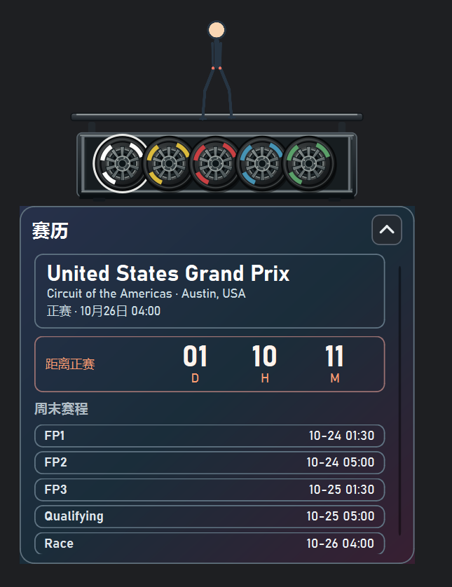
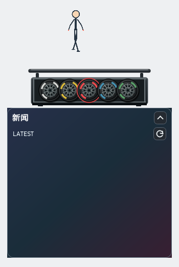

# SuperMax

**An F1-themed desktop companion powered by Python, PySide6 and local LLMs.**

SuperMax 是一款基于 Python 开发的 Windows 桌面伴侣，起源于个人对 Formula 1 的兴趣。项目将动态桌宠、F1 赛事信息、新闻聚合与本地 AI 摘要结合，并集成 To-Do 和番茄钟等日常效率工具。

桌宠采用 PySide6 透明悬浮窗口，支持角色动画、自由拖动与交互操作。五个轮胎式导航入口分别对应赛历、赛果、新闻、任务管理和专注计时。

公开版本使用原创的程序化火柴人动画。私人主题化角色素材不包含在仓库中。

## Preview

### Race Calendar · 赛历



提供 F1 赛程、比赛时间、正赛倒计时及赛事信息查询，并通过本地缓存减少重复请求。

### F1 News · 新闻



聚合 F1 新闻及官方赛事信息，结合规则筛选与本地 LLM 生成简洁中文摘要。

更多界面与演示说明见 [Demo](docs/DEMO.md)。

## Features

**Animated Desktop Pet**
- PySide6 透明无边框窗口、置顶显示与自由拖动
- 24 FPS 角色动画与交互式轮胎导航
- 可折叠功能面板，支持公开与私人主题配置

**F1 Data & Race Calendar**
- 基于 Jolpica F1 API 获取赛历及比赛结果
- 显示正赛倒计时、上一站领奖台与积分排名
- SQLite 本地缓存，支持优先加载已有赛事数据

**News Aggregation & Local AI**
- 整合 Formula 1、FIA、Sky Sports F1 等新闻来源
- 支持定时刷新、去重、异常重试及 SQLite 缓存
- 根据新闻类别和用户反馈进行轻量排序
- 通过 Ollama 运行本地 Qwen 模型，生成中文新闻摘要
- 使用 [F1 News Skill](skills/f1_news/SKILL.md) 约束摘要格式、新闻优先级与信息可靠性判断
- 模型不可用时自动降级，保留原始新闻信息

**Productivity Tools**
- 四象限 To-Do 任务管理
- SQLite 持久化存储
- 25 分钟番茄钟及专注状态控制

## Tech Stack

| 技术 | 用途 |
| --- | --- |
| Python 3.10 | 核心开发语言 |
| PySide6 / Qt | 桌面 GUI、动画与交互 |
| QThread / QTimer | 后台任务与定时调度 |
| HTTP / JSON | 外部 API 与新闻数据交互 |
| SQLite | 赛事、新闻、用户反馈及任务持久化 |
| Ollama / Qwen | 本地大语言模型推理 |
| pypdf | FIA 文档文本处理 |
| unittest | 自动化测试 |

### Project Structure

| 模块 | 功能 |
| --- | --- |
| `main.py` / `animation.py` | 程序入口与动画播放 |
| `demo_ui.py` / `ui_icons.py` | GUI 页面及交互 |
| `f1_data.py` / `race_store.py` | 赛事数据与缓存 |
| `news_sources/` / `news_service.py` | 新闻采集与后台刷新 |
| `news_store.py` / `news_articles.py` | 新闻存储与内容处理 |
| `local_llm.py` / `news_skill.py` | 本地模型与摘要规则 |
| `task_store.py` | 任务管理与持久化 |
| `public_assets/` | 原创公开动画与生成脚本 |
| `tests/` | 自动化测试 |

## Getting Started

### Requirements

- Windows 10 / 11
- Python 3.10
- 网络连接（获取在线赛事与新闻数据）
- Ollama（可选，仅用于本地 AI 摘要）

### Installation

在项目根目录执行：

```powershell
py -3.10 -m venv .venv
.\.venv\Scripts\python.exe -m pip install -r requirements.txt
```

检查运行环境：

```powershell
.\.venv\Scripts\python.exe main.py --check
```

启动应用：

```powershell
.\.venv\Scripts\python.exe main.py
```

公开版默认使用原创火柴人动画，无需下载其他角色素材。

### Optional: Local LLM

SuperMax 支持通过 Ollama 在本地运行 Qwen，无需调用云端大模型 API。

安装 [Ollama](https://ollama.com/) 后，下载模型：

```powershell
ollama pull qwen2.5:1.5b
```

程序默认尝试使用 `qwen2.5:1.5b`，也可通过环境变量 `SUPERMAX_OLLAMA_MODEL` 指定其他已安装模型。

模型摘要结合 `skills/f1_news/SKILL.md` 中的规则进行结构化生成与校验。模型无法连接或结果不符合要求时，程序保留原始新闻信息。

**不安装 Ollama 也可以使用桌宠、赛事查询、新闻浏览及效率工具。**

## Testing

运行自动化测试：

```powershell
.\.venv\Scripts\python.exe -X faulthandler -m unittest discover -s tests -q
```

运行基础启动检查：

```powershell
.\.venv\Scripts\python.exe main.py --smoke
```

截至 2026 年 10 月 24 日：

- 52 项自动化测试通过
- 已验证公开动画的透明通道、循环连续性和实际播放
- 已进行 GUI 启动、新闻后台任务及退出流程检查
- 已验证本地 Qwen 模型调用与结构化结果处理

项目曾出现间歇性 Windows 原生访问异常。已修复确认的 Qt 线程退出与对象清理问题，现有回归测试通过，但此前的个别原生异常尚未完成根因定位。

详细测试记录见 [Validation](docs/VALIDATION.md)。

## Roadmap

- [ ] 继续优化 F1 新闻来源覆盖与摘要准确性
- [ ] 完善 News Skill 和个性化新闻筛选
- [ ] 丰富原创角色动画与交互反馈
- [ ] 优化桌面组件的视觉设计与使用体验
- [ ] 持续完善测试、异常处理及发布流程

## License & Disclaimer

本项目采用 [MIT License](LICENSE)，适用于仓库中有权授权的原创代码及公开动画素材。

SuperMax 是非官方个人兴趣项目，与 Formula 1、FIA、Pirelli 及相关车队不存在官方关联。

公开版采用原创程序化角色，不包含私人主题化角色资产、第三方品牌图片或未经授权的字体文件。第三方依赖、新闻内容及相关商标仍归各自权利人所有，并遵循其适用的许可与使用条件。
